# Лабораторная работа №2 — MatrixLab5

## Многопоточные вычисления, синхронизация и исследование производительности

**Язык программирования:** C#  
**Платформа:** .NET 8  
**Операционная система:** Windows 10 Pro  
**Процессор:** Intel Core i5-10400F

---

## Цель работы

Научиться распараллеливать вычисления с помощью потоков и процессов, синхронизировать доступ к общим данным и экспериментально определять оптимальное число потоков для конкретного компьютера.

## Описание проекта

В рамках лабораторной работы реализованы:

- многопоточное умножение матриц;
- распределение строк матрицы между потоками;
- отображение прогресса выполнения;
- генерация матриц в отдельном процессе и передача данных через IPC;
- умножение нижнетреугольной матрицы на обычную;
- статическое и динамическое распределение работы;
- возведение квадратной матрицы в степень;
- синхронизация потоков с помощью барьера (`Barrier`);
- проведение замеров времени и исследование производительности.

---

## Используемые технологии

- C#
- .NET 8
- `System.Threading.Thread`
- `Interlocked`
- `lock`
- `Barrier`
- `Stopwatch`
- Межпроцессное взаимодействие (IPC)
- Git / GitHub

---

## Характеристики компьютера

| Параметр | Значение |
|---|---|
| Процессор | Intel Core i5-10400F @ 2.90 GHz |
| Физические ядра | 6 |
| Логические процессоры | 12 |
| Кэш L3 | 12 MB |
| Оперативная память | 15.92 GB (≈16 GB) |
| Операционная система | Windows 10 Pro |
| Версия ОС | 10.0.19045 |
| Архитектура | x64 |
| Среда выполнения | .NET 8.0.4 |
| SDK | 8.0.425 |

---

## 1. Многопоточное умножение матриц

Реализовано умножение матриц `A` и `B` с сохранением полного результата в матрице `C`.

Каждый поток получает свой блок строк матрицы результата. Для распределения работы используются границы блоков, вычисляемые пропорционально количеству потоков, что позволяет распределить остаток строк и корректно работать даже при количестве потоков, превышающем количество строк.

Вычисления выполняются вручную с помощью вложенных циклов. Для повышения эффективности используется порядок циклов `i → t → j`, при котором элементы матриц обрабатываются более последовательно в памяти.

Для контроля выполнения используется общий счётчик обработанных строк с атомарным увеличением через `Interlocked`. Прогресс выводится в консоль в процентах.

Результат сохраняется в общей матрице, а для проверки вычислений выводится контрольная сумма.

### Пример запуска

```bash
dotnet run -c Release -- multiply 300 300 300 4
```

### Результат выполнения

<p align="center">
  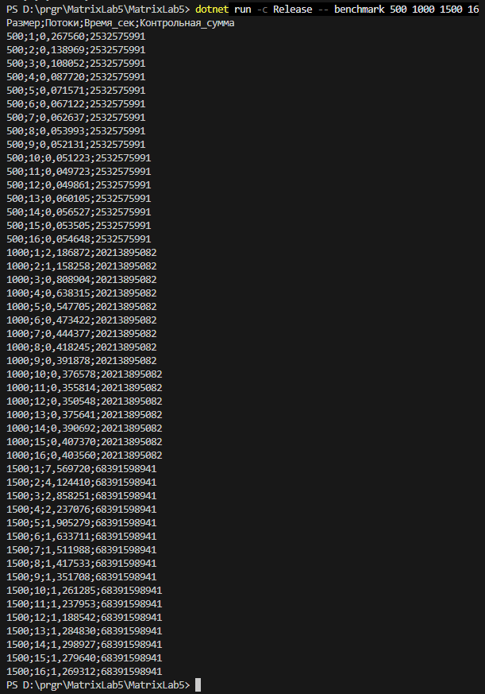
</p>

<p align="center">
  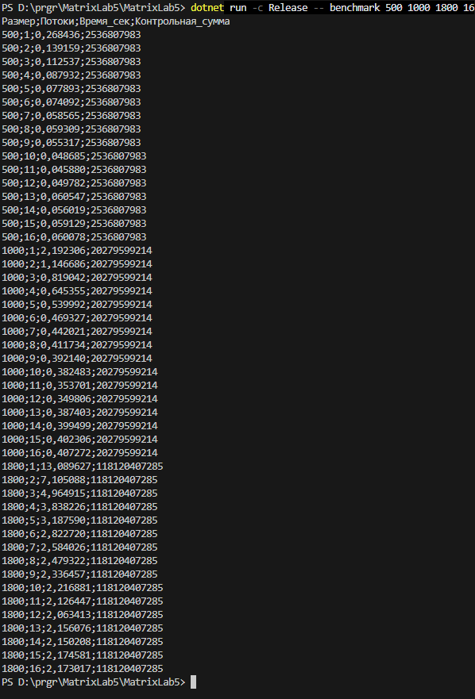
</p>

---

## 2. Генерация матриц в отдельном процессе (IPC)

Для генерации матриц используется отдельный дочерний процесс. Основной процесс запускает генератор, передаёт ему параметры размеров матриц, после чего получает сгенерированные данные.

Для передачи матриц используется анонимный канал (pipe) с бинарным форматом данных. Размеры матриц передаются первыми, затем элементы записываются в бинарном формате.

Использование бинарного формата позволяет избежать дополнительной обработки текстовых данных и уменьшить объём передаваемой информации.

Генерация выполняется до запуска таймера вычислений, поэтому время создания матриц не включается в измерение времени умножения.

---

## 3. Умножение нижнетреугольной матрицы

Реализовано умножение нижнетреугольной матрицы `A` на матрицу `B`.

Матрица `A` хранится в виде массива массивов разной длины. Для строки с индексом `i` хранятся только элементы от `0` до `i`, поэтому нулевые элементы выше главной диагонали не занимают память.

Это позволяет сократить количество операций по сравнению с умножением обычных квадратных матриц.

### Статическое распределение (Static)

Строки заранее распределяются между потоками. Каждый поток обрабатывает свой непрерывный блок строк.

### Динамическое распределение (Dynamic)

Потоки поочерёдно получают очередную строку из общего счётчика, защищённого блокировкой. Такой способ позволяет более равномерно распределить нагрузку, поскольку нижние строки матрицы требуют больше вычислений, чем верхние.

### Пример запуска

```bash
dotnet run -c Release -- triangular 500 300 8 static
```

```bash
dotnet run -c Release -- triangular 500 300 8 dynamic
```

### Статическое распределение

<p align="center">
  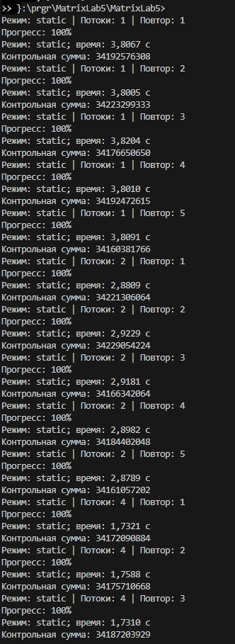
</p>

<p align="center">
  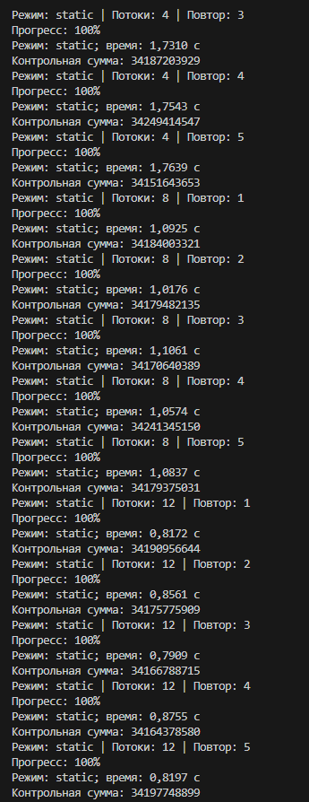
</p>

### Динамическое распределение

<p align="center">
  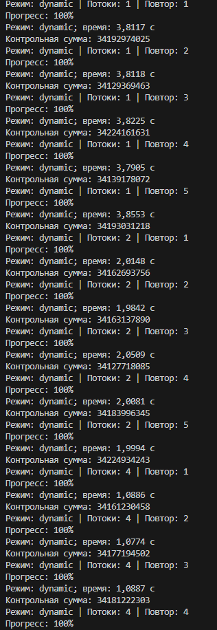
</p>

<p align="center">
  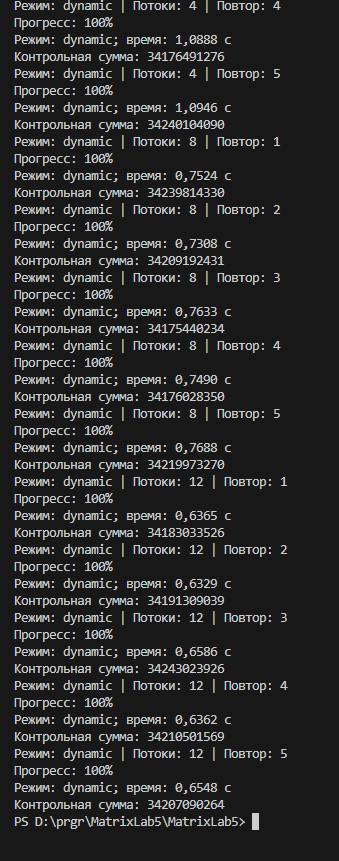
</p>

---

## 4. Возведение матрицы в степень

Реализовано возведение квадратной матрицы в степень с использованием многопоточности.

Вычисление выполняется последовательным умножением матрицы на саму себя. Для хранения промежуточных результатов используются два буфера:

- `current` — матрица текущего шага;
- `next` — матрица, в которую записывается результат следующего умножения.

Для синхронизации потоков применяется `Barrier`. После завершения вычисления своего блока строк каждый поток ожидает остальные. Когда все потоки завершили текущий шаг, буферы меняются местами. Это гарантирует, что следующий шаг использует полностью рассчитанную матрицу предыдущего шага.

Для предотвращения переполнения вычисления выполняются по модулю `1_000_000_007`.

### Пример запуска

```bash
dotnet run -c Release -- power 100 5 4
```

### Результаты выполнения

<p align="center">
  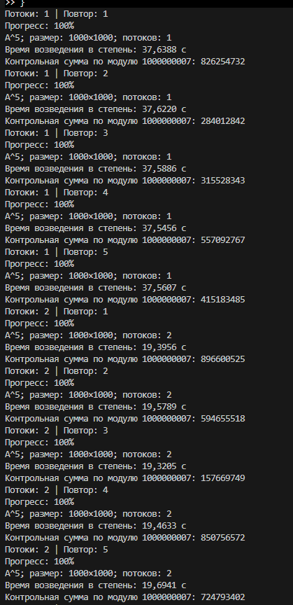
</p>

<p align="center">
  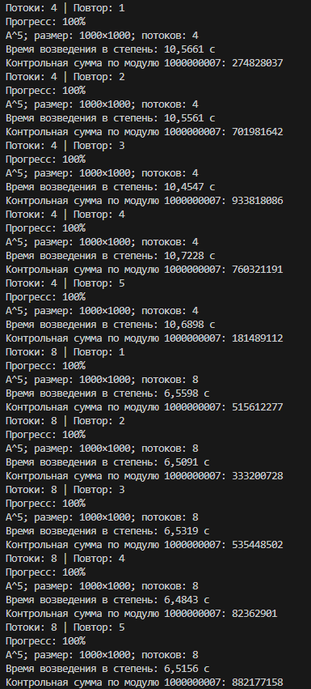
</p>

<p align="center">
  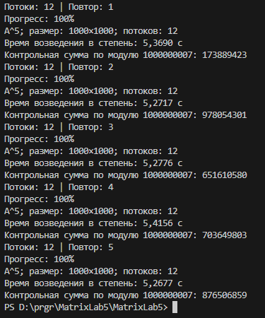
</p>

---

## 5. Исследование производительности

Для исследования производительности были проведены серии запусков с разными размерами матриц и количеством потоков.

В измерениях использовались оптимизированные сборки `Release`. Для каждой комбинации выполнялось пять повторов. После сортировки результатов отбрасывались минимальное и максимальное значения, а среднее вычислялось по оставшимся трём измерениям.

Для анализа использовались:

- время выполнения;
- контрольная сумма результата;
- количество потоков;
- размер матрицы;
- сравнение статического и динамического распределения.

### Пример запуска benchmark

```bash
dotnet run -c Release -- benchmark 500 1000 1500 16
```

В ходе экспериментов исследовалось влияние количества потоков на время вычислений, а также сравнивалась производительность при различных размерах матриц.

---

## 6. Контроль корректности

Корректность вычислений проверяется с помощью контрольных сумм матриц-результатов.

Для небольших матриц дополнительно выводится вся матрица. Для больших размеров полный вывод не выполняется, чтобы не влиять на производительность программы.

В процессе реализации также учитываются:

- корректное распределение строк между потоками;
- ожидание завершения потоков с помощью `Join`;
- атомарное обновление счётчиков;
- синхронизация доступа к общим данным;
- смена буферов после завершения всех потоков на каждом шаге возведения в степень.

---

## 7. Скриншоты среды выполнения

### Версия .NET

<p align="center">
  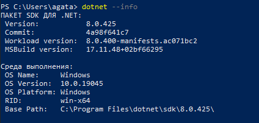
</p>

### Операционная система

<p align="center">
  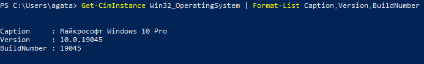
</p>

### Процессор

<p align="center">
  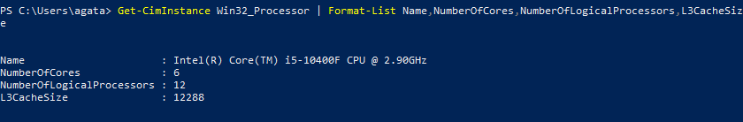
</p>

### Оперативная память

<p align="center">
  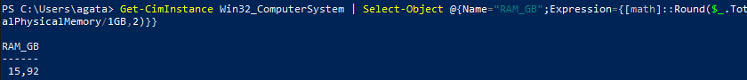
</p>

---

## 8. Вывод

В ходе лабораторной работы были реализованы многопоточные вычисления с использованием стандартных средств C#. Освоено создание потоков, распределение вычислительной нагрузки, синхронизация доступа к общим данным и отображение прогресса выполнения. Реализовано взаимодействие между процессами с помощью IPC, а также статическое и динамическое распределение строк для умножения нижнетреугольной матрицы. Для возведения матрицы в степень использованы два буфера и барьер синхронизации. Проведены эксперименты с различным количеством потоков, позволяющие исследовать влияние параллелизма на производительность. Полученные результаты показывают, что увеличение числа потоков не всегда приводит к пропорциональному ускорению вычислений.

---

## Запуск проекта

Для запуска необходим установленный .NET 8 SDK.

Клонирование репозитория:

```bash
git clone https://github.com/USERNAME/MatrixLab5.git
```

Переход в каталог проекта:

```bash
cd MatrixLab5
```

Запуск в Release:

```bash
dotnet run -c Release
```

Справка по командам:

```bash
dotnet run -c Release
```

---

**Лабораторная работа выполнена на C# с использованием .NET 8.**
